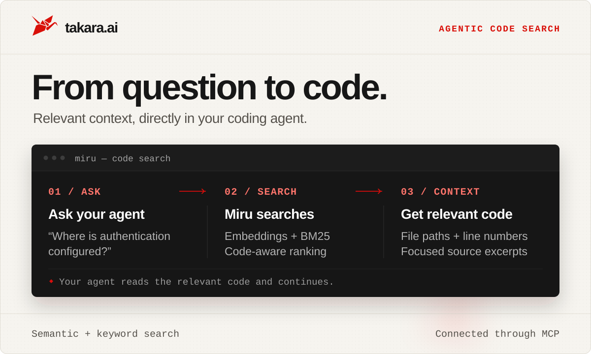

# Miru (見る)

[](https://github.com/takara-ai/miru-code/actions/workflows/ci.yml) [](https://github.com/takara-ai/miru-code/actions/workflows/ci.yml) [](./LICENSE) [](https://bun.sh)

**Hybrid code search for AI coding agents.**

Ask where something happens in your codebase. Miru returns relevant file paths, line numbers, and source excerpts through MCP.

<picture>
  <source media="(max-width: 600px)" srcset="docs/miru-workflow-diagram-mobile.svg">
  
</picture>

## Install

Requires [Bun](https://bun.sh) 1.1 or later, with `bunx` on your PATH.

### Claude Code (recommended)

Run inside Claude Code:

```text
/plugin marketplace add takara-ai/miru-code
/plugin install miru@miru
```

Reload plugins or restart Claude Code, then ask:

```text
Use Miru to find where authentication is configured in this project.
```

If credentials are missing, Claude can use Miru's `auth` tool to start sign-in. Approve the login code, then retry the search. Plugin credentials are separate from CLI credentials.

### Other agents

See [agent integrations](docs/integrations.md) for Codex and Cursor plugins. The Cursor plugin provides skills and rules; use the CLI installer below to connect its MCP tools.

## Install (CLI fallback)

For terminal use or agents configured through the CLI:

```bash
bun add -g @takara-ai/miru-code
miru setup
miru install
```

Choose your agents in the installer, then restart them. See [supported integrations](docs/integrations.md#cli-integrations). Use `miru uninstall` to remove the configuration.

## Try it

```bash
miru search "auth middleware" ./src
miru locate REDIS_HOST ./src
miru expand src/auth.ts 42 ./src
miru find-related src/auth.ts 42 ./src
```

Use `--json` for scripts. Run `miru <command> -h` for options.

## MCP tools

| Tool | Purpose |
| --- | --- |
| `search` | Find code by meaning |
| `locate` | Find exact strings, regex matches, or filenames |
| `expand` | Read neighbouring chunks in the same file |
| `find_related` | Find similar code in other files |
| `auth` | Sign in or configure a SageMaker endpoint |
| `read_benchmark` | Read token-savings totals when benchmark mode is enabled |

The optional `repo` argument defaults to the server's working directory. Miru builds the index on first use and watches local files for changes.

## How it works

Miru combines embeddings, BM25, and code-aware ranking. Tree-sitter provides syntax-aware chunks for 26 languages, with structural and line-based fallbacks for other files.

See [chunking and caching](docs/reference.md#how-it-works) and the [ranking evaluation](docs/always-on-ranker.md).

## Privacy and API usage

By default, Miru sends file contents as source chunks and search queries over HTTPS to Takara for embeddings. API usage may incur costs under your Takara plan.

For embeddings on your own infrastructure, use [AWS SageMaker](docs/self-hosted-sagemaker.md). Set `MIRU_WORKSPACE_ROOT` to restrict local MCP repository paths to one directory.

## Documentation

- [Reference](docs/reference.md): CLI commands, MCP parameters, configuration, and benchmarks
- [Agent integrations](docs/integrations.md): plugin capabilities, configuration paths, and optional skills
- [Contributing](CONTRIBUTING.md): development setup, checks, and releases

## Credits

Miru builds on work by [MinishLab](https://github.com/MinishLab):

- [semble](https://github.com/MinishLab/semble): file walking, indexing, BM25, hybrid search, and ranking signals.
- [potion-code](https://huggingface.co/minishlab/potion-code-16M) and [Model2Vec](https://github.com/MinishLab/model2vec): WordPiece tokenizer.

See [NOTICE](NOTICE) for attribution and licence text.

## License

[MIT](LICENSE)
